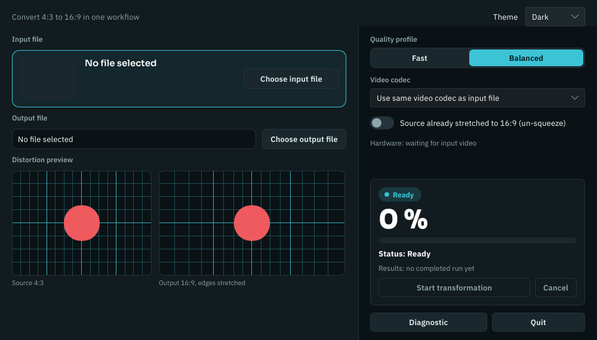

# Superview

[English](README.md) · **Français**

<!-- ALL-CONTRIBUTORS-BADGE:START - Do not remove or modify this section -->
[](#contributors-)
<!-- ALL-CONTRIBUTORS-BADGE:END -->

Convertit une vidéo 4:3 en 16:9 sans bandes noires et sans rogner l'image.
Superview étire progressivement les bords et laisse le centre intact, à la
manière du SuperView de GoPro.


Remarquez que le texte au centre garde ses proportions pendant que les côtés
s'élargissent.

> Plateformes officiellement prises en charge : **Windows** et **Linux**
> (Ubuntu 24.04 LTS et suivantes).
> Superview est distribué et maintenu comme une application **à interface
> graphique uniquement**.

## Téléchargement et installation

Il n'y a rien à installer à côté. Chaque téléchargement embarque son propre
`ffmpeg` et son `ffprobe`, et Superview les utilise de préférence à ceux de la
machine — délibérément, parce que la version de FFmpeg installée détermine si
l'encodage matériel fonctionne, tout simplement.

### Windows

1. Ouvrez la **[dernière version](https://github.com/Canaill51/superview/releases/latest)**.
   Sous **Assets**, cliquez sur le fichier dont le nom se termine par
   **`-windows-x86_64-setup.exe`**. Il pèse environ 95 Mo — c'est FFmpeg qui
   occupe l'essentiel — et il arrive dans votre dossier `Téléchargements`.

2. Votre navigateur peut signaler que le fichier est rarement téléchargé et
   proposer de le supprimer. Choisissez **Conserver**.
   [Pourquoi Windows se méfie de Superview](#pourquoi-windows-se-méfie-de-superview)
   explique cet avertissement.

3. **Double-cliquez sur le fichier téléchargé.** Windows affiche une fenêtre
   bleue intitulée **« Windows a protégé votre ordinateur »**. Elle ne propose
   que **Ne pas exécuter**, qui n'est pas ce que vous voulez. Cliquez sur le
   petit lien **Informations complémentaires**, puis sur le bouton **Exécuter
   quand même** qui apparaît en dessous. Windows ne pose la question qu'une fois
   par fichier téléchargé.

4. L'installateur ne demande aucun droit d'administrateur : il installe Superview
   pour votre seul compte, avec `ffmpeg.exe` et `ffprobe.exe`, dans
   `%LOCALAPPDATA%\Programs\Superview`. Cliquez sur **Suivant** jusqu'à
   **Installer**, puis sur **Terminer**. Cochez au passage la création d'un
   raccourci sur le Bureau si vous en voulez un.

Superview est ensuite dans le menu Démarrer. Pour le retirer : **Paramètres** →
**Applications** → **Applications installées** → **Superview** →
**Désinstaller**. Installer une version plus récente par-dessus une ancienne la
met à jour sur place.

#### Pourquoi Windows se méfie de Superview

Les versions publiées ne sont pas signées avec un certificat de signature de
code. Ces certificats se louent à l'année auprès d'une autorité de
certification, et ce projet n'en a pas — Windows n'a donc aucun nom d'éditeur à
vous montrer, et SmartScreen n'a aucun historique de téléchargement pour un
fichier qu'il voit pour la première fois. L'avertissement dit que Windows ne
sait pas qui a produit ce fichier, pas qu'il est dangereux. Certains antivirus
vont plus loin et le mettent en quarantaine sans demander ; la cause est la même
signature manquante.

Ce que vous pouvez vérifier à la place : chaque version publie un
`checksums.txt`, le code source de ce que vous exécutez est ce dépôt, et
l'installateur est assemblé par
[`.github/workflows/release.yml`](.github/workflows/release.yml) sur les
serveurs de GitHub — pas sur l'ordinateur portable de quelqu'un.

### Linux

Téléchargez le fichier dont le nom se termine par `-linux-x86_64.AppImage`
depuis la [dernière version](https://github.com/Canaill51/superview/releases/latest).
C'est un fichier unique qui contient l'application et son FFmpeg : rien à
extraire, rien à installer. Rendez-le exécutable, puis lancez-le :

```bash
chmod +x superview-*-linux-x86_64.AppImage
./superview-*-linux-x86_64.AppImage
```

Dans un gestionnaire de fichiers, l'équivalent est : clic droit →
**Propriétés** → autoriser l'exécution du fichier comme un programme, puis
double-clic.

Une AppImage a besoin de FUSE 2 pour se monter. Ubuntu 24.04 ne l'installe pas :
`sudo apt install libfuse2t64`, ou passez outre FUSE et lancez
`./superview-*-linux-x86_64.AppImage --appimage-extract-and-run`.

### Vérifier votre téléchargement

Facultatif, et utile si vous voulez autre chose que la parole du téléchargement.
Placez `checksums.txt`, publié à côté des téléchargements, dans le même dossier :

```bash
sha256sum -c checksums.txt          # Linux
```

Sous Windows, affichez les deux valeurs et comparez-les à l'œil :

```powershell
(Get-FileHash .\superview-*-windows-x86_64-setup.exe -Algorithm SHA256).Hash
Select-String -Path .\checksums.txt -Pattern windows
```

Les deux doivent montrer les mêmes 64 caractères, la casse mise à part.

## Utiliser Superview

L'interface de l'application est en anglais ; les libellés ci-dessous sont donc
donnés tels qu'ils apparaissent à l'écran.

1. Cliquez sur **Choose input file** (choisir le fichier d'entrée) et prenez un
   MP4 en 4:3.
2. Choisissez un **Quality profile** (profil de qualité) — **Fast** ou
   **Balanced**.
3. Éventuellement, choisissez un **Video codec**.
4. Cliquez sur **Choose output file** (choisir le fichier de sortie).
5. Cliquez sur **Start transformation** (lancer la transformation).
6. Attendez la fin de l'encodage.



**MP4 en entrée, MP4 en sortie.** Les sélecteurs de fichiers ne proposent que du
MP4, et l'extension de sortie est imposée.

**Si votre caméra a déjà étiré l'image**, cochez *Source already stretched to
16:9 (un-squeeze)* : les modes d'enregistrement SuperView de GoPro, la Caddx
Tarsier et leurs semblables stockent une capture 4:3 étirée en 16:9. Superview
dés-étire alors le centre au lieu d'élargir l'image. La courbe est une
approximation de l'étirement inverse, pas une reproduction de l'algorithme d'une
caméra donnée.

Remarques :

- Les deux profils de qualité demandent le même débit : 4/3 de celui de la
  source, ce qui correspond exactement à l'augmentation du nombre de pixels
  quand une image 4:3 est élargie en 16:9 — la sortie conserve donc le nombre de
  bits par pixel de la source. Ils ne diffèrent que par le préréglage de
  l'encodeur. `Fast` encode plus vite ; `Balanced` utilise un préréglage plus
  lent, un peu plus détaillé à taille égale.
- L'application demande confirmation avant d'écraser un fichier de sortie
  existant.
- L'interface affiche le chemin matériel prévu avant le lancement, par exemple
  `h264_nvenc + D3D11VA`, puis le chemin réellement utilisé une fois la
  conversion terminée.
- Une vidéo plus haute que 9:8 — une vidéo de téléphone en portrait, par
  exemple — est refusée : l'élargir en 16:9 replierait l'image sur elle-même aux
  deux bords. Le mode un-squeeze garde la largeur de l'image et n'est pas
  concerné.

### En cas de problème

**Appuyez sur *Diagnostic*.** Ce bouton rend compte de la présence de
ffmpeg/ffprobe, de l'espace disque libre, de la mémoire et du processeur, et
**des encodeurs que cette machine accepte réellement**, en citant les mots de
FFmpeg pour chaque refus. Joignez sa sortie à tout rapport de bug.

C'est aussi la réponse à « mon GPU sera-t-il utilisé ? » — et non
`ffmpeg -encoders | grep nvenc`, qui énumère ce avec quoi le binaire a été
compilé et ne sait rien de votre pilote. Voir
[docs/hardware-support.md](docs/hardware-support.md) (en anglais) pour les
familles de GPU qui fonctionnent généralement, et ce qu'il faut vérifier quand
une carte censée être prise en charge n'apparaît pas.

`cannot find ffmpeg/ffprobe on your system`, depuis une version installée,
signifie que ses `ffmpeg` et `ffprobe` ne sont plus à côté de l'application :
réinstallez-la plutôt que de déplacer ou de supprimer ces fichiers.
Depuis une compilation des sources, mettez FFmpeg dans le `PATH`. Pour imposer
un FFmpeg particulier à Superview, faites pointer `SUPERVIEW_FFMPEG_DIR` sur le
dossier qui contient les deux — il l'emporte sur la copie embarquée et sur le
`PATH`.

**`not enough memory for this conversion`** est Superview qui refuse de démarrer
ce que la machine ne peut pas tenir. Un encodage sur processeur demande environ
0,27 Go de mémoire par mégapixel de l'image **de sortie**, et 0,43 Go quand la
source est en 10 bits — un clip 4K en 4:3 s'élargit en 5120×2880, soit environ
6 Go. Le message cite les deux chiffres. Fermez d'autres applications,
convertissez une vidéo comptant moins de pixels, ou choisissez un encodeur
matériel dans la liste des codecs si *Diagnostic* dit que cette machine en
accepte un : un encodage sur GPU n'est pas soumis à cette vérification.

**Si une conversion s'arrête malgré tout d'elle-même et que la fenêtre se
ferme**, la mémoire a quand même manqué — l'estimation ci-dessus est une
moyenne, pas une garantie. Le système tue l'encodeur, et sous Linux il arrête
ensuite l'application entière avec lui. Le journal le nomme aussi, avec la
mémoire disponible à cet instant : cherchez `ffmpeg was killed by the system` ou
`The system signalled the application to stop`.

Le binaire annonce sa propre identité — numéro de version, commit à partir
duquel il a été construit, et si l'arbre était modifié — dans le titre de la
fenêtre, la première ligne du rapport Diagnostic et le journal au démarrage.
Citez-la dans tout rapport de bug.

## Ce que fait Superview

- **Mise à l'échelle dynamique** : les zones extérieures sont étirées plus
  fortement, le centre conserve ses proportions
- **Accélération matérielle** : utilise les encodeurs H.264/H.265 que la machine
  accepte réellement, et retombe sur le processeur sinon
- **Fidèle à la source** : une source 10 bits reste en 10 bits lors d'un
  encodage H.265 (les HERO 10 et suivantes enregistrent en 10 bits), toutes les
  pistes audio sont reportées, et la date d'enregistrement est préservée
- **Configuration souple** : contraintes de débit et choix d'encodeur
  personnalisables
- **Parcours guidé** : trois étapes, avec les boîtes de dialogue natives du
  système

L'algorithme repose sur
[l'implémentation Python originale de Banelle](https://intofpv.com/t-using-free-command-line-sorcery-to-fake-superview),
adaptée à Go et à FFmpeg.

> C'est une *approximation* du SuperView de GoPro, pas une reproduction : la
> courbe de distorsion vient de
> [l'implémentation originale de Banelle](https://intofpv.com/t-using-free-command-line-sorcery-to-fake-superview)
> et vise un résultat comparable, pas un rendu identique.

## Accélération matérielle

Au démarrage, Superview demande à chaque encodeur d'encoder une image, et ne
retient que ceux qui répondent. Il retombe sur `libx264`/`libx265`, côté
processeur, dès qu'aucun chemin matériel n'est utilisable. Demander plutôt que
lire `ffmpeg -encoders` est tout l'intérêt : cette liste dit avec quoi le
binaire a été compilé et ne peut pas voir votre pilote.

Quand aucun encodeur matériel ne fonctionne pour le codec de la source mais
qu'un encodeur de l'autre famille fonctionne, Superview l'utilise plutôt que de
retomber sur le processeur — un Intel HD 620 refuse tous les encodeurs H.265 et
accepte le H.264, et encoder du H.264 sur le GPU l'emporte largement sur du
H.265 sur quatre cœurs. La fenêtre et le journal l'annoncent, et disent ce que
cela coûte : une source en 10 bits est enregistrée en 8 bits quand la conversion
passe en H.264. Choisir vous-même un encodeur dans la liste des codecs l'emporte
toujours sur ce comportement.

Un encodeur matériel est également interrogé sur l'image qu'il va réellement
recevoir, et pas seulement sur une petite. Les encodeurs ont des bornes — ce même
Intel HD 620 plafonne à 4096 pixels de côté, et un clip 4K en 4:3 s'élargit à
5120 — donc la question est reposée à la vraie taille dès qu'un fichier est
choisi, et Superview recule sur le processeur avant de démarrer si la réponse est
non. La fenêtre dit quel encodeur va réellement tourner, et pourquoi, avant même
que vous appuyiez sur *Start transformation*.

**Les versions publiées embarquent leur propre FFmpeg**, et Superview le
préfère à celui qui est installé sur la machine. L'exigence de pilote de NVENC
est figée à la compilation de FFmpeg : deux versions se réclamant toutes deux de
la « 8.1.2 » peuvent réclamer des pilotes NVIDIA différents, et la mauvaise vous
coûte l'encodage matériel sans autre symptôme qu'une conversion lente.
`SUPERVIEW_FFMPEG_DIR` est la porte de sortie — voir
[Configuration](#configuration).

Quels encodeurs sont visés, quelles familles de GPU fonctionnent, et pourquoi le
plancher de pilote appartient à la version compilée de FFmpeg plutôt qu'à FFmpeg
lui-même : **[docs/hardware-support.md](docs/hardware-support.md)** (en anglais).

## Configuration

Superview cherche `superview.yaml` dans cet ordre, et utilise le premier fichier
trouvé :

1. `$SUPERVIEW_CONFIG` (chemin explicite, l'emporte sur tout le reste)
2. à côté de l'exécutable
3. `~/.config/superview/superview.yaml` (Linux) ou `%AppData%\superview\superview.yaml` (Windows)
4. le répertoire de travail courant

Si aucun n'existe, les valeurs par défaut internes s'appliquent. Voici le
`superview.yaml` livré avec le projet :

```yaml
min_bitrate: 102400       # ~0.1 Mbps minimum
max_bitrate: 209715200    # ~200 Mbps maximum
temp_dir_prefix: "superview-*"
encoder_codecs: ["264", "265", "hevc"]
log_level: info
performance_mode: safe_performance    # safe = re-encode audio to AAC | safe_performance = copy audio
video_preset: ""         # optional: ultrafast..veryslow, traduit par encodeur (NVENC p1-p7, AMF, QSV)
filter_threads: 0         # 0 = auto/default
encoder_threads: 0        # 0 = auto/default
```

> Le fichier livré et les valeurs par défaut internes concordent : `performance_mode`
> vaut `safe_performance` par défaut (copier la piste audio telle quelle, avec repli
> sur l'AAC si la copie est refusée), avec ou sans `superview.yaml`. Réglez `safe`
> pour toujours réencoder l'audio en AAC.

Une clé que Superview ne connaît pas, ou un `min_bitrate` supérieur à
`max_bitrate`, fait ignorer le fichier entier plutôt que de l'appliquer à moitié :
le journal nomme la clé ou les deux valeurs, et les variables d'environnement
ci-dessous s'appliquent toujours.

Surcharge par variables d'environnement :

```bash
export SUPERVIEW_MIN_BITRATE=262144
export SUPERVIEW_MAX_BITRATE=209715200
export SUPERVIEW_LOG_LEVEL=debug
export SUPERVIEW_PERFORMANCE_MODE=safe_performance
export SUPERVIEW_VIDEO_PRESET=fast
export SUPERVIEW_FILTER_THREADS=4
export SUPERVIEW_ENCODER_THREADS=8
./superview-gui
```

`SUPERVIEW_FFMPEG_DIR` est la seule qui n'a pas d'équivalent dans le fichier :
elle désigne le dossier contenant `ffmpeg` et `ffprobe`, et l'emporte à la fois
sur la copie embarquée et sur le `PATH`. Elle existe parce que la version
embarquée est une décision unique appliquée à toutes les machines, et qu'une
machine à qui elle convient mal a besoin d'une issue qui ne consiste pas à
attendre une nouvelle publication.

```bash
SUPERVIEW_FFMPEG_DIR=/usr/bin ./superview-gui
```

## Architecture

### Structure du projet

```
superview/
├── cmd/superview/              # L'interface : point d'entrée, boîtes de dialogue natives, métadonnées Fyne
│   ├── gui_main.go                 # Point d'entrée de l'interface (Fyne)
│   ├── gui_native_dialog_*.go      # Boîtes de dialogue natives (zenity/kdialog, PowerShell)
│   └── FyneApp.toml                # Métadonnées d'empaquetage Fyne
├── internal/common/            # Logique d'encodage, partagée par toute interface
│   ├── pipeline.go             # PerformEncoding : validation, fichier de travail, métriques
│   ├── encode.go               # Un passage ffmpeg : arguments, chaîne de filtres, cascade de repli
│   ├── pgm.go                  # Géométrie de sortie, formule de distorsion, écriture PGM
│   ├── session.go              # Répertoire temporaire d'une conversion
│   ├── video.go                # Sortie ffprobe et sa validation
│   ├── tools.go                # Recherche de ffmpeg/ffprobe, lecture de leurs capacités
│   ├── memory.go               # Garde-fou mémoire, chiffré par pixel de sortie
│   ├── errors.go               # Erreurs typées, sentinelles, journal du paquet
│   ├── config.go               # Chargement de la configuration et valeurs par défaut
│   ├── hardware.go             # Classement des encodeurs, mise en place des périphériques
│   ├── probe.go                # Demande à chaque encodeur d'encoder une image ; les règles du verdict
│   ├── health.go               # Contrôles de santé du système (le bouton Diagnostic)
│   ├── metrics.go              # Métriques d'encodage
│   ├── observability.go        # Enregistrement des événements et journalisation
│   ├── security.go             # Validation des chemins et des entrées
│   ├── command-*.go            # Mise en place des processus, par système
│   ├── health_disk_*.go        # Sonde d'espace disque libre, par plateforme
│   ├── *_test.go               # Tests unitaires, tests golden et tests d'intégration
│   └── testdata/ffprobe/       # Sorties ffprobe enregistrées, contre lesquelles l'analyseur est testé
├── docs/                       # Contrats techniques, journal d'audit, prise en charge matérielle
├── packaging/                  # Script de l'installateur Windows et de l'AppImage Linux
├── superview.yaml              # Configuration par défaut
├── Makefile                    # Cibles locales de construction et de qualité
├── THIRD_PARTY_NOTICES.md      # Le FFmpeg livré avec les versions, et sa licence
├── .github/scripts/            # Contrôles au moment de la publication (le plancher de pilote NVENC)
└── RELEASING.md                # Comment une version est publiée
```

### Pipeline d'encodage

```
Startup → CheckFfmpeg → ProbeHardwareSupport → ApplyEncoderProbe
Input → CheckVideo → InitEncodingSession → GeneratePGM → EncodeVideo → CleanUp → Output
                               ↓
                ValidateBitrate + FindEncoder
                VideoSpecs.Validate()
                EncodingMetrics / Observability hooks
```

## Développement

> Le code actuel vise **Go 1.26+**.

Une compilation depuis les sources ne livre aucun FFmpeg : une machine de
développement en a donc besoin d'un dans le `PATH`.

### Dépendances de compilation sous Linux

```bash
sudo apt update
sudo apt install -y ffmpeg libgl1-mesa-dev xorg-dev libwayland-dev libxkbcommon-dev
```

> `libwayland-dev` et `libxkbcommon-dev` sont nécessaires depuis Fyne 2.8, qui
> est passé à GLFW 3.4 et à son backend Wayland. Ce sont des dépendances de
> compilation uniquement.

Facultatif, pour les boîtes de dialogue natives (repli sur celles de Fyne
sinon) :

```bash
sudo apt install -y zenity
```

### Chaîne d'outils Windows

```powershell
winget install -e --id Gyan.FFmpeg --version 8.1.1 --accept-package-agreements --accept-source-agreements
winget install -e --id GoLang.Go --accept-package-agreements --accept-source-agreements
winget install -e --id BrechtSanders.WinLibs.POSIX.UCRT --accept-package-agreements --accept-source-agreements
```

> ⚠️ **Le `--version 8.1.1` porte le poids de la chose ; ne le retirez pas.**
> `winget install Gyan.FFmpeg` tout court installe aujourd'hui une version
> compilée contre des en-têtes NVIDIA qui exigent le pilote **610.00** — un
> numéro que la branche RTX Enterprise, celle des cartes professionnelles,
> n'atteint pas : sa branche de pilotes s'arrête à 597.06. Sur une telle
> machine, NVENC ne peut jamais démarrer, quel que soit le pilote. La `8.1.1`
> exige 570.0 et fonctionne ; éprouver les chemins matériels contre la 8.1.2
> mesurerait donc autre chose que ce qu'on croit.
> [docs/hardware-support.md](docs/hardware-support.md) contient le tableau
> mesuré, et [RELEASING.md](RELEASING.md#bumping-the-bundled-ffmpeg) traite de
> l'épinglage.

### Compiler depuis les sources

Une compilation depuis les sources ne produit aucun paquet : elle utilise donc
le FFmpeg présent dans le `PATH`.

Interface Windows :

```powershell
go build -ldflags="-H=windowsgui" -o superview-gui.exe ./cmd/superview
.\superview-gui.exe
```

Linux :

```bash
go build -o superview-gui ./cmd/superview
./superview-gui
```

### Compilation et tests

```bash
make test        # go test -race ./... -- tout le module, comme le fait la CI
make coverage    # couverture sur ./..., celle que mesure le seuil de 50 % en CI
make check       # fmt, vet, lint, couverture et govulncheck
make build       # binaire de l'interface pour la plateforme courante
make clean       # résidus de compilation, de couverture et d'empaquetage
```

`make test` et `make coverage` exigent **ffmpeg dans votre PATH** et échouent en
son absence, au lieu de sauter en silence les tests qui s'en servent -- les
quatre tests d'intégration et le test d'équivalence du remap, qui sont à eux
seuls tout ce qui vérifie une conversion réelle de bout en bout.

`make build-gui-windows` s'exécute nativement sous Windows : Fyne dessine à
travers cgo, donc poser `GOOS=windows` depuis Linux prive de chaîne C et l'étape
d'édition de liens échoue. Le workflow de publication construit chaque
plateforme sur son propre exécuteur, pour la même raison.

Posez `SUPERVIEW_REQUIRE_FFMPEG=1` pour transformer en échecs les tests
dépendants de ffmpeg qui seraient sautés — c'est ce que fait la CI, afin qu'une
suite verte ne puisse pas signifier « rien n'a été encodé ».

Les publications se font depuis l'onglet Actions et sont documentées dans
[RELEASING.md](RELEASING.md) (en anglais). Il n'y a pas de script de publication
local.

Pour les contributeurs : [RELEASING.md](RELEASING.md) explique comment une
version est publiée, [docs/CONTRATS.md](docs/CONTRATS.md) ce que le code
garantit, et [docs/hardware-support.md](docs/hardware-support.md) quels GPU
fonctionnent généralement.

## Contributors ✨

Merci à ces personnes ([clé des emoji](https://allcontributors.org/docs/en/emoji-key)) :


<!-- ALL-CONTRIBUTORS-LIST:START - Do not remove or modify this section -->
<!-- prettier-ignore-start -->
<!-- markdownlint-disable -->
<table>
  <tr>
    <td align="center"><a href="https://github.com/naorunaoru"><br /><sub><b>Roman Kuraev</b></sub></a><br /><a href="#ideas-naorunaoru" title="Ideas, Planning, & Feedback">🤔</a> <a href="https://github.com/Canaill51/superview/commits?author=naorunaoru" title="Code">💻</a></td>
    <td align="center"><a href="https://github.com/dangr0"><br /><sub><b>dangr0</b></sub></a><br /><a href="https://github.com/Canaill51/superview/issues?q=author%3Adangr0" title="Bug reports">🐛</a></td>
    <td align="center"><a href="https://github.com/dga711"><br /><sub><b>DG</b></sub></a><br /><a href="#ideas-dga711" title="Ideas, Planning, & Feedback">🤔</a> <a href="https://github.com/Canaill51/superview/commits?author=dga711" title="Tests">⚠️</a></td>
    <td align="center"><a href="https://github.com/tommaier123"><br /><sub><b>Nova_Max</b></sub></a><br /><a href="https://github.com/Canaill51/superview/commits?author=tommaier123" title="Documentation">📖</a></td>
  </tr>
</table>

<!-- markdownlint-enable -->
<!-- prettier-ignore-end -->
<!-- ALL-CONTRIBUTORS-LIST:END -->

